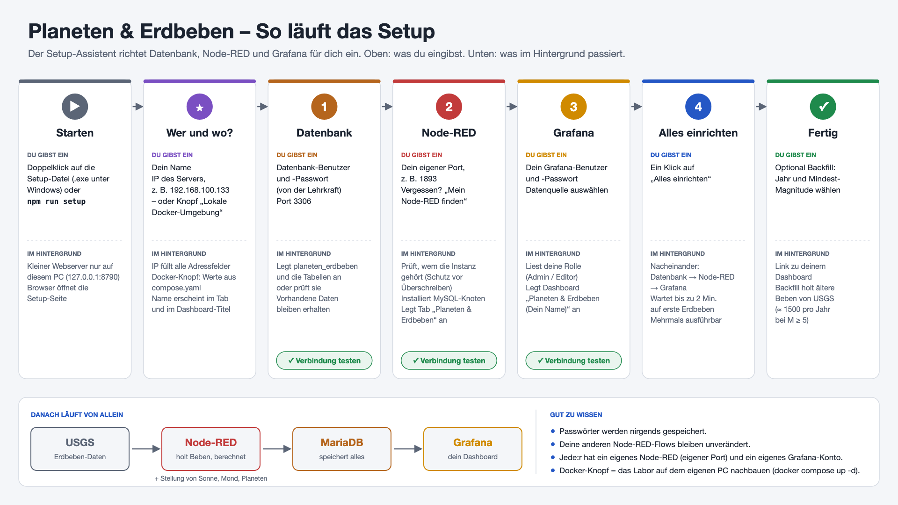

# Planeten & Erdbeben

Do planetary positions correlate with earthquakes? Pipeline:

```
USGS earthquake feed ──> Node-RED ──> MySQL/MariaDB <── Grafana
                         (computes Sun, Moon and
                          planet positions itself)
```

**Learning units (German):** [lernen/](lernen/README.md) explains every part of the project with exercises
(`npm run lernen` checks them) and a cheat sheet for explaining it in class.

**Local environment without a Pi:** `docker compose up -d` starts MariaDB, Node-RED and Grafana on this PC
([compose.yaml](compose.yaml)); then `npm run setup` → "Lokale Docker-Umgebung". Step by step, in German:
[ERSTE-SCHRITTE.md](ERSTE-SCHRITTE.md). `node tools/lernpaket.js` packs project + learning units +
Docker environment into `dist/PlanetenErdbeben-Lernpaket.zip` (no executables, no real passwords).

## Quick start: setup wizard (for classes)

The setup wizard configures an **existing** database, Node-RED and Grafana over the network,
for example on a Raspberry Pi at `192.168.100.133`. Nothing has to be installed by hand.

[](praesentation/Setup-Ablauf.png)

*The whole process on one page (in German). Vector version: [Setup-Ablauf.svg](praesentation/Setup-Ablauf.svg).*

1. Start the program for your system from `dist/`:
   - Windows: `planeten-erdbeben-setup-windows-x64.exe` (double-click; on the first start
     Windows SmartScreen may warn about an unknown publisher: "More info" > "Run anyway")
   - Linux (PC): `planeten-erdbeben-setup-linux-x64`, Linux (Raspberry Pi 64-bit): `planeten-erdbeben-setup-linux-arm64`
     (`chmod +x` once, then run it). If it fails with `libatomic.so.1: cannot open shared object file`:
     `sudo apt install libatomic1` (Node.js 26 for Linux needs it; slim systems lack it).
2. A setup page opens in the browser. Enter your name and the server's IP address once; all address
   fields fill themselves. Then enter, separately:
   - **your Node-RED port** (everyone has their own, e.g. 1892, 1893, …). "Mein Node-RED finden" scans the
     server and lists every Node-RED with who set it up. Plus the editor login, if one is enabled.
   - **the MariaDB login** (from the teacher; not the Grafana login),
   - **your own Grafana account**.
   - The **table prefix** fills itself from your name (`anna_mueller_`): everyone gets their own tables in the
     shared database. "Lokale Docker-Umgebung" also reads the ports from `.env` (e.g. `DB_PORT=3307`).
   - **"Tabellen"** (database card): create them automatically, **write them yourself** (an exercise: the wizard
     shows which columns and keys are needed, runs your SQL and checks the result with suggested fixes,
     [shared/schema-spec.js](shared/schema-spec.js)), or **copy and paste** the ready SQL.
   - **"Wie?"** (Node-RED card): set up automatically, or **export the flow as JSON** (with your database address
     and prefix, without passwords) and import it in the Node-RED editor yourself.

   Click **Verbindung testen** for each part, then **Alles einrichten**.
3. The wizard then
   - creates the database and your own tables (only missing ones; existing data is kept). Older tables get
     the new columns (positions seen from the Sun), and Node-RED recomputes their events,
   - installs `node-red-node-mysql` in Node-RED and adds or updates the tab "Planeten & Erdbeben"
     (other flows are not touched),
   - creates the Grafana data source and dashboard, installs the plugin Business Charts for the solar system
     panel (needs a Grafana *server* admin), and in Grafana 13 sets up the "View" switch (map / solar system),
   - waits until the first earthquakes arrive with computed positions.
4. On the last page you can load older years of earthquakes (backfill) and watch the counters.

Each part can be switched off. Running the wizard again is safe.

Several people on one Pi:
- The wizard writes "Eingerichtet von: <name>" into the Node-RED tab. If someone else's name is already there
  (wrong port), it stops and only continues after "Trotzdem überschreiben" is ticked.
- Every person gets their own Grafana dashboard, "Planeten & Erdbeben (<name>)". Click a quake on the map:
  the sky panel and the solar system show that quake. In Grafana 13 (dynamic dashboards) the "View" switch at
  the top changes between Earth map and solar system ([grafana/dynamic-layout.js](grafana/dynamic-layout.js));
  older Grafana versions show both side by side.
- **Looking for correlations:** the "Correlation finder" panels at the bottom compare a Moon position (phase,
  height above the quake region, distance) between quakes and control events, with or without aftershocks.
  `npm run korrelation` does the same for every metric and body, with corrected p-values, a cross-check on
  the second half of the data, and a refusal where the stored controls are no fair baseline
  ([src/correlation.js](src/correlation.js), learning unit 11).
- Grafana **Admins** get their own data source. **Editors** cannot create data sources; they choose an
  existing one. So the teacher runs the wizard once with an admin account, and pupils then pick
  that data source. Viewers cannot create dashboards.
- Everyone shares **one database but has their own tables**: the wizard puts the name in front, e.g.
  "Anna Müller" gets `anna_mueller_events`, `anna_mueller_body_positions` and `anna_mueller_aspects`
  (field "Tabellen-Präfix", filled in from the name and editable). The tectonic plates (`plates`,
  `plate_points`) are shared. Node-RED reads the prefix from the tab variable `TABLE_PREFIX`, and the
  dashboard queries are built with it. Clear the field to share the plain tables `events`, ... instead
  (duplicate quakes are then ignored). Classes set up before the prefix existed: running the wizard again
  starts new, empty personal tables; the old shared tables stay untouched.

Requirements on the servers:
- **MariaDB/MySQL** must be reachable from the network. On Raspberry Pi OS set
  `bind-address = 0.0.0.0` in `/etc/mysql/mariadb.conf.d/50-server.cnf`, and use a user that may log in
  from other hosts (`'name'@'%'`).
- **Node-RED** needs internet access (USGS, GitHub for the plate boundaries, and npm for `astronomy-engine`/`node-red-node-mysql`), and
  `functionExternalModules: true` in `settings.js`, which is the default.
  Behind a proxy: see [LABOR-PROXY.md](LABOR-PROXY.md) (German).
- **Windows PCs behind the school proxy:** `npm install`, git and winget need the proxy too.
  [proxy-windows/](proxy-windows/README.md) (German) has two double-click scripts: one enters the proxy into
  npm, git, pip, winget and the environment, the other installs Node.js, Git and ripgrep.
- **Grafana** needs an Admin login. The solar system panel needs the plugin **Business Charts**
  (`volkovlabs-echarts-panel`, Apache ECharts). The wizard installs it if the login is a Grafana *server* admin
  and Grafana has internet; otherwise: `sudo grafana cli plugins install volkovlabs-echarts-panel` and restart
  Grafana. Without it only that one panel stays empty. (The Docker environment preinstalls it.)

Building the programs (needs Node.js 25.5+, downloads the official Node.js binaries once):
```
npm install
npm run build-setup                       # dist/: Windows x64, Linux x64, Linux arm64
node setup-wizard/build.js darwin-arm64   # optional: macOS
npm run setup                             # run the wizard from source instead
npm run build-cockpit                     # dist/: Lern-Cockpit for Windows x64, Linux x64, Linux arm64
npm run lernen:ui                         # run the Lern-Cockpit from source instead
```

## Project layout

| Path | What |
|---|---|
| `src/planets.js` | The calculation (astronomy-engine): positions seen from the quake location and from the Sun. Used by the API and copied into the Node-RED flow. |
| `src/correlation.js` | Correlation finder: quakes vs. control events per bin, declustering, corrected p-values, fairness check. `npm run korrelation` ([tools/korrelation.js](tools/korrelation.js)) |
| `app.js` | Optional HTTP API: `GET /api/sky?lat=&lon=&date=` (port 3001; Grafana uses 3000). `npm run api` |
| `db/schema.sql` | Tables: `events` (quakes + control events), `body_positions` (incl. `helio_lon_deg`, `helio_dist_au`), `aspects`, shared `plates`, `plate_points`. The wizard creates the first three per person with a prefix ([shared/tables.js](shared/tables.js)) |
| `node-red/flow-builder.js` | Builds the Node-RED tab from `node-red/functions/*.js`. `npm run flow-import` writes `flow-import.json` for Menu > Import |
| `grafana/queries.sql` | All panel queries. `grafana/dashboard-builder.js` turns them into the dashboard (`npm run dashboard`) |
| `grafana/solar-system.echarts.js` | Drawing code of the solar system panel (Business Charts / Apache ECharts) |
| `grafana/dynamic-layout.js` | Rows with show/hide rules for the "View" switch (dashboard schema v2, Grafana 13) |
| `setup-wizard/` | The wizard: `server.js` (local web server), `ui.html` (page), `lib/` (one module per server, `docker-env.js` for the Docker ports), `build.js` |
| `proxy-windows/` | Windows scripts for the school proxy (npm, git, winget) |
| `praesentation/quellen/` | Python scripts (ReportLab) that generate the PDF handouts in `praesentation/` and `proxy-windows/`; how to run them: `stil.py` |

After changing a function, a query or `src/planets.js`, run the wizard again (or rebuild the programs) to
update Node-RED and Grafana.

## Local development setup on this Mac

Since 2026-11-19 this Mac uses the same Docker environment as the pupils ([compose.yaml](compose.yaml)):
- `docker compose up -d` / `stop` / `start`. The containers restart on their own whenever Docker Desktop runs.
- MariaDB on **127.0.0.1:3307** (3306 stays free for XAMPP and other projects), Node-RED on 1880, Grafana on 3000
  (`admin` / `admin-lernen`). Logins in `.env`.
- The old XAMPP setup: logins in `.env.xampp`, data backup in `backup/` (both ignored by Git and Docker).
  No longer used by this project: XAMPP's `planeten_erdbeben` database, the global Node-RED with
  `node-red/data` + `node-red/flow.json` (`npm run node-red`), the standalone Grafana install, and the
  planet API on 3001 (`npm run api`, optional).

## How the data is collected

- **Ingest:** every 5 minutes the M4.5+ quakes of the last day are fetched from USGS; the backfill
  button loads one year from the USGS catalog. Every quake is stored together with one **control event**:
  same place, random time in the 2 years before. The control events are the baseline: without them, any
  distribution you see might simply be how the planets are distributed anyway.
- **Enrich:** every minute Node-RED takes up to 600 events without positions, computes the positions of
  Sun, Moon and the planets (20 per second), and writes them with the aspects. Failures are retried
  on the next run.
- **Plates:** at start and then weekly Node-RED loads the tectonic plates (PB2002, Bird 2002) from
  [GitHub](https://github.com/fraxen/tectonicplates) into `plates` (outline as geometry) and `plate_points`.
  The map shows the plate boundaries, and a bar chart counts the quakes per plate (`ST_Contains`).

## Reading the results

- Compare earthquakes (red) with control events (grey). With 12 signs × 10 bodies × 45 body pairs × 5 aspects,
  a few will differ by chance alone; treat a difference as real only if it holds up on a new time range.
- Aftershocks cluster in time, so one big quake can add hundreds of events with nearly the same sky.
  For statistics, decluster: "Aftershocks: Main shocks only" in the correlation finder, or `npm run korrelation`
  (default: a quake drops out if a stronger one was within 3 days and 300 km).
- The control events lie in the 2 years before each quake. That is a fair baseline only for things that repeat
  many times in that time (the Moon). For slow planets quakes and controls see different years, so any
  difference says nothing; `npm run korrelation` refuses those comparisons.
- The physically plausible link is **tides** (Sun + Moon). Published studies find small effects of
  tidal stress on quake timing. Moon phase, Moon distance and Moon altitude are the most promising
  variables. Tidal forces from the planets are many orders of magnitude weaker.
